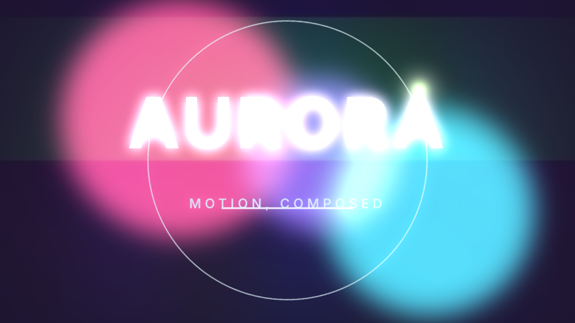
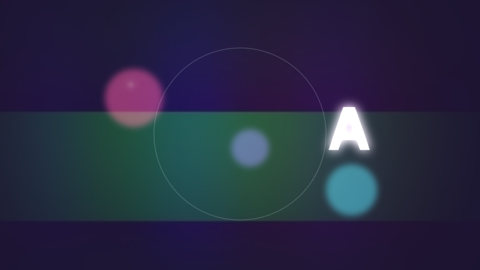
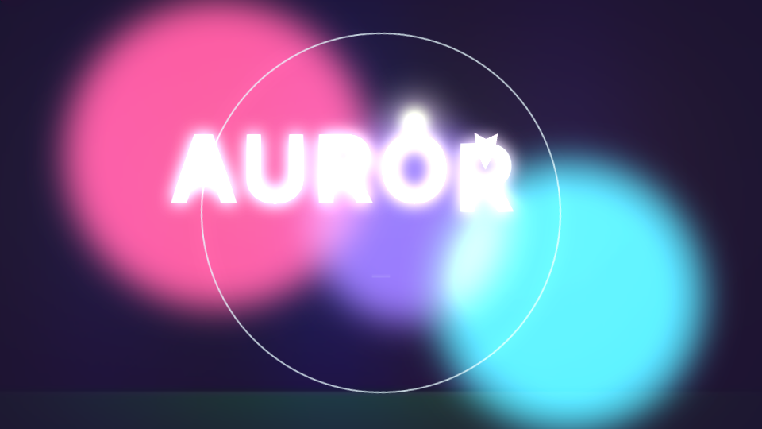
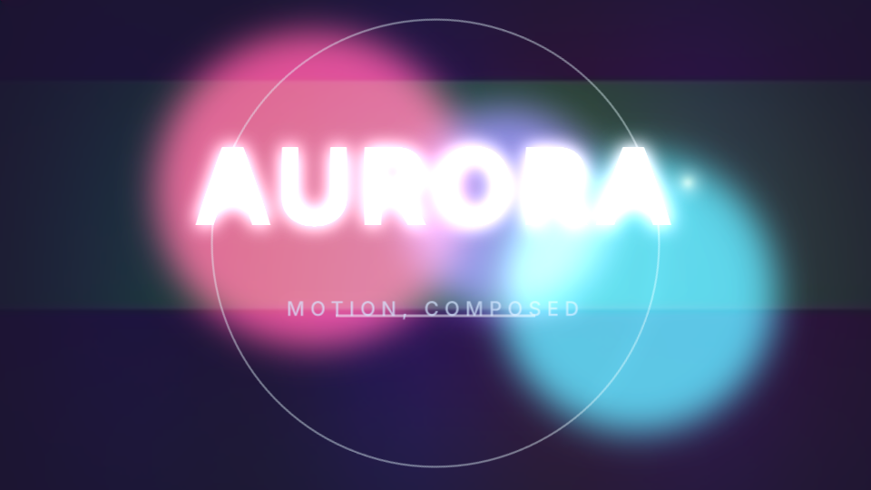

# EffectCraft MCP

An AI-controllable fork of [storytold/effectcraft](https://github.com/storytold/effectcraft) — an open-source After Effects-style compositor written in pure Rust. This repository keeps the upstream engine, licenses, and attribution, and drives it with a Model Context Protocol server: stdio for desktop clients, and loopback HTTP for local agents.

The Aurora demo below was built entirely by calling those tools (compositions, solids, text, shapes, footage, nulls, an adjustment layer, eased keyframes, glow, masks, blend modes, a precomp, and a render queue).



| | |
|---|---|
| Project | [`examples/aurora/aurora.ecproj`](examples/aurora/aurora.ecproj) |
| Film | [`examples/aurora/aurora.mp4`](examples/aurora/aurora.mp4) |
| Loop | [`examples/aurora/aurora.gif`](examples/aurora/aurora.gif) |
| Builder | [`examples/aurora/build_aurora.py`](examples/aurora/build_aurora.py) |





## Setup

Rust **1.95+** (this tree uses edition 2024). The first build fetches the FilmCraft codec crates from GitHub.

```sh
cargo build --release -p effectcraft-cli
./target/release/effectcraft-cli --version
```

Headless frames render on the CPU. `--gpu` attaches the GPU compositor when an adapter is available.

The desktop app, the CLI, and the MCP server share one command registry, so a tool call is the same operation a menu would run. Upstream's product README is preserved at [docs/UPSTREAM.md](docs/UPSTREAM.md). Deeper agent notes live in [docs/agents.md](docs/agents.md) and [docs/mcp.md](docs/mcp.md).

## MCP client config

Stdio is the transport Cursor, Claude Code, and Claude Desktop expect. From this repo, after a release build:

```json
{
  "mcpServers": {
    "effectcraft": {
      "command": "/absolute/path/to/effectcraft-mcp/target/release/effectcraft-cli",
      "args": ["mcp", "--empty"]
    }
  }
}
```

[`/.mcp.json`](.mcp.json) registers that server, plus `effectcraft-demo`, which opens the Aurora project. Add `--demo` to boot the upstream sample project, or `--project path/to/file.ecproj` to open a file. `--autosave` checkpoints a dirty headless project before each tool reply.

Loopback HTTP speaks the same JSON-RPC messages, one request at a time. It binds only `127.0.0.1` or `localhost`; any other address is rejected.

```sh
./target/release/effectcraft-cli mcp --empty --http 127.0.0.1:8765
```

```sh
curl -s http://127.0.0.1:8765/health
curl -s http://127.0.0.1:8765/mcp \
  -H 'content-type: application/json' \
  -d '{"jsonrpc":"2.0","id":1,"method":"tools/list"}'
```

`POST /shutdown` stops the HTTP server. Progress notifications for a long render stay on the stdio transport.

A running desktop app can be driven instead of the headless session:

```sh
effectcraft --control 9877
effectcraft-cli mcp --bridge 9877
```

Bridge mode adds `screenshot` and the `ui_*` tools.

## Tools

36 tools. Headless sessions expose 27; the nine UI tools appear only in bridge mode. Each tool's JSON schema is returned by `tools/list`. Unknown argument keys are rejected with the accepted list.

| Tool | What it does |
|---|---|
| `list_commands` | Engine command catalogue: id, label, menu, shortcut, parameter doc, whether it can run. `filter`, `enabled_only`, `schemas`. |
| `describe_command` | One command in full, including a JSON Schema of its parameters. |
| `execute_command` | Run any engine command by id. Edits are undoable. Unknown parameter keys are rejected. |
| `command_list` | Same catalogue as `list_commands`. |
| `command_run` | Run one command (`id`, `params`). |
| `command_batch` | Run commands in order. Each edit has its own undo step. Stops on the first error unless `stop_on_error` is false. |
| `batch` | Several commands as **one** undo step. `"$N.key"` substitutes an earlier result. A failure rolls the batch back. |
| `run_script` | JavaScript with an After Effects-style object model (`app.project`, layers, `setValueAtTime`, effects). |
| `get_state` | Active comp, time, selection, tool, plus build capabilities (command count, effects, formats). |
| `get_project` | Items, bit depth, active comp, dirty flag, undo stack. |
| `get_comp` | Comp settings and the layer stack (id, name, type, in/out, blend, parent, switches). |
| `get_layer` | A layer's property tree. Every leaf has a `path`. `flat: true` returns a compact list. |
| `get_property` | One property at a comp time: value, keyframes, interpolation, expression. |
| `set_property` | Static value, a keyframe (`time`), or an expression. `timeBase` is `layer` or `comp`. |
| `add_keyframe` | One key or `keys: [{time, value}]`, then `interpolation`: `linear`, `bezier`, `hold`, `easyEase`, `easyEaseIn`, `easyEaseOut`. |
| `list_effects` | Effect registry: id, name, category, GPU and 32-bpc flags, parameters. |
| `add_effect` | Apply an effect and set parameters in one undo step. Returns `effects/#n` and each parameter path. |
| `list_fonts` | Families the text engine can use (bundled and installed), with styles. |
| `render_frame` | PNG of a frame. `path` writes it, `max_side` scales it, `transparent` keeps alpha. |
| `render_preview` | Same frame as a PNG reply, without a default file path. |
| `open_project` | Open an `.ecproj` (`path`), the built-in demo (`demo: true`), or an empty project (`new: true`). |
| `save_project` | Save, or Save As when `path` is set. |
| `undo` / `redo` | Step through the undo stack. |
| `history` | Branching history. `goto` jumps to any state without dropping the others. |
| `doc_inspect` | Project overview plus the active composition. Also published as the `effectcraft://document` resource. |
| `script_ui` | Drive ScriptUI windows a script opened: list, get, click, set, close. |
| `screenshot` | **Bridge.** PNG of the window, a panel, or an element. |
| `ui_inspect` | **Bridge.** Window, workspace, viewer, timeline, playback. |
| `ui_elements` | **Bridge.** Hit targets from the last frame (`tools.Selection`, `timeline.cti`, …). |
| `ui_click` / `ui_drag` / `ui_key` / `ui_type` / `ui_set` | **Bridge.** Click, drag, press a shortcut, type, or set viewer and timeline state. |
| `control` | **Bridge.** Any control-channel method (`ui.menu.invoke`, `ui.playback`, …). |

`effectcraft://commands` is the command catalogue as a resource.

### Engine commands the tools drive

`execute_command` / `command_run` reach the whole registry (hundreds of ids — `list_commands` is the live list). The groups used to author and render a composition:

| Area | Commands |
|---|---|
| Project | `file.newProject`, `file.open`, `file.save`, `file.saveAs`, `file.import` |
| Composition | `comp.new`, `comp.settings`, `comp.open`, `comp.workArea`, `comp.setPosterTime` |
| Layers | `layer.newSolid`, `layer.newText`, `layer.newShape`, `layer.newNull`, `layer.newAdjustment`, `layer.addItem` (image, video, precomp) |
| Transform & timing | `prop.set`, `prop.addKey`, `keys.set`, `layer.timing`, `layer.setParent` |
| Keyframe easing | `add_keyframe` with `easyEase` / `easyEaseIn` / `easyEaseOut` / `bezier` / `hold` / `linear` |
| Effects | `effect.apply`, `effect.list`, `add_effect`, then `set_property` on `effects/#n/…` |
| Masks | `layer.addMask`, `mask.new`, `layer.setMask`, `mask.setVertex` |
| Blending | `layer.setBlendMode` (`Screen`, `Add`, `Multiply`, …), `layer.setTrackMatte` |
| Precomps | `layer.precompose` |
| Time | `time.set`, `time.nextFrame`, `time.start`, `time.end`, `time.workAreaStart` |
| Render | `renderQueue.add`, `renderQueue.render`, `render_frame`, `render_preview` |
| Query | `get_state`, `get_project`, `get_comp`, `get_layer`, `get_property`, `doc_inspect` |

Shapes accept `kind`: `rect`, `rounded`, `ellipse`, `star`, `polygon`. Text accepts font, style, size, fill, tracking, and per-character animators (`layer.addTextAnimator`). Export formats include H.264, HEVC, AV1, ProRes, WebM, PNG, JPEG, TIFF, EXR, GIF, WAV, and AIFF.

### A short session

```json
{"name":"execute_command","arguments":{"command":"comp.new","params":{"name":"Intro","width":1920,"height":1080,"frameRate":30,"duration":4,"background":"#07060f"}}}
{"name":"execute_command","arguments":{"command":"layer.newText","params":{"text":"Hello","name":"Title","size":140,"fill":"#ffffff"}}}
{"name":"add_keyframe","arguments":{"layer":"Title","path":"transform/position","keys":[{"time":0,"value":[200,540]},{"time":1.4,"value":[960,540]}],"interpolation":"easyEase"}}
{"name":"add_effect","arguments":{"layer":"Title","effect":"Glow","values":{"threshold":40,"radius":24,"intensity":1.2}}}
{"name":"render_frame","arguments":{"time":1.0,"max_side":960}}
{"name":"save_project","arguments":{"path":"intro.ecproj"}}
```

Times on `add_keyframe` and `set_property` are layer seconds unless `timeBase` is `"comp"`. `render_frame` and `get_property` take comp seconds.

## Aurora demo

960×540, 24 fps, 4 seconds. The builder (`examples/aurora/build_aurora.py`) starts `effectcraft-cli mcp --empty` and then:

1. Creates the **Aurora** composition and reads `get_state`, `command_list`, `list_effects`, and `list_fonts`.
2. Paints a solid with **4-Color Gradient**, imports a still and a short video, and lays them in with Screen / Add blending and an ellipse mask.
3. Builds three blurred ellipse orbs, parents them to a null, and precomps that rig as **Aurora Field**.
4. Animates a stroked ring, a star, and a rule with easy-ease scale, position, rotation, and opacity.
5. Sets **AURORA** with a per-character animator and Glow, then **MOTION, COMPOSED**.
6. Grades the frame with an adjustment layer, seeks to the poster frame, saves the `.ecproj`, writes four PNG frames, and renders H.264 and GIF through the render queue.

Rebuild after a debug or release build:

```sh
EFFECTCRAFT_CLI=target/release/effectcraft-cli python3 examples/aurora/build_aurora.py
```

## Tests

Protocol tests live in `crates/automation` (stdio, resources, confinement, and the loopback HTTP round trip). QA scenarios under `crates/automation/tests/qa/` build real projects through the same tools.

```sh
cargo test -p effectcraft-automation --lib
```

## По-русски

**EffectCraft MCP** — форк [storytold/effectcraft](https://github.com/storytold/effectcraft) (лицензия MIT или Apache-2.0). Это композитор в духе After Effects на чистом Rust: композиции, слои, ключевые кадры, эффекты, маски и очередь рендера. ИИ управляет им через MCP.

- Сервер: `effectcraft-cli mcp` (stdio) или `effectcraft-cli mcp --http 127.0.0.1:8765` (только loopback).
- Сборка: Rust 1.95+, `cargo build --release -p effectcraft-cli`.
- 36 инструментов: проект, слои (solid, text, shape, image, video, null, adjustment), трансформы, ключи с ease, эффекты, маски, режимы наложения, прекомпы, время, рендер, захват кадра и чтение состояния.
- Демо «Aurora»: `examples/aurora/aurora.ecproj`, `aurora.mp4`, `aurora.gif`, кадры в `examples/aurora/frames/`.

Авторские права на движок остаются у ArtCraft Team и участников EffectCraft. См. `LICENSE-APACHE`, `LICENSE-MIT`, `NOTICE`, `ATTRIBUTION.md`.

## License and credits

EffectCraft is licensed under the MIT License or the Apache License 2.0, at your option. This fork redistributes that work unchanged except for the MCP HTTP transport, the Aurora demo, and these docs.

- Upstream: [github.com/storytold/effectcraft](https://github.com/storytold/effectcraft)
- Copyright: ArtCraft Team and the EffectCraft contributors (`NOTICE`)
- Third-party assets and fonts: `ATTRIBUTION.md`
- Trademarks in `docs/brand/` are not covered by the code license (`docs/brand/LICENSE-brand.txt`)

## Limitations

- The HTTP transport is loopback-only and serves one request at a time. Render progress and cancellation are implemented on stdio.
- Headless rendering uses the CPU unless the process is started with `--gpu`.
- `screenshot` and the `ui_*` tools need a desktop app started with `--control`.
- The Aurora film is a 4-second 960×540 piece. Full-HD timelines with large blurs are slower on CPU.
- This fork imports a snapshot of upstream. It is not an automatically updated mirror.
